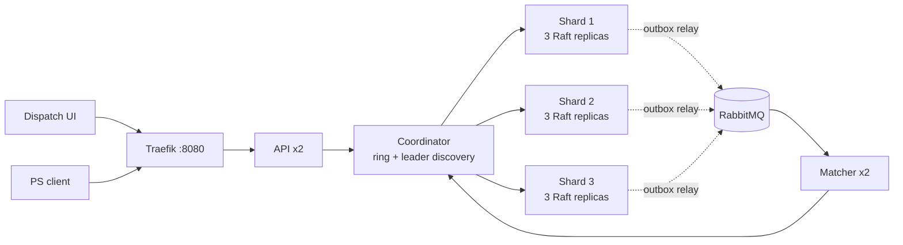

# ReliefGrid

ReliefGrid matches emergency requests (water, food, medicine, transportation,
shelter) to nearby resources that can serve them. Requests and resources live in a
sharded store: three shards, each replicated three times with Raft, so each shard
keeps working when one of its replicas is lost. Matching runs asynchronously through
RabbitMQ, and every claim is checked inside the replicated state machine, so a
resource is never given to two requests. It implements the course problem statement
*Emergency Response Matching* (PS9) on Docker and Kubernetes (kind).

## Architecture



- **API** (`cmd/api`): the public REST API under `/api/v1`, with keyed retries.
- **Matcher** (`cmd/matcher`): consumes RabbitMQ events, claims resources, relays
  each shard's outbox and runs the reconcilers.
- **Coordinator** (`cmd/coordinator`): owns the consistent-hash ring (xxhash64,
  128 virtual nodes), tracks storage heartbeats and finds each shard's leader.
- **Storage** (`cmd/storagenode`): 3 shards × 3 replicas. Each shard is a HashiCorp
  Raft group with a deterministic SQLite state machine.
- **RabbitMQ**: durable queues with publisher confirms and manual acks.
- **UI** (`ui/`): the dispatch workspace with a map, served through Traefik.
- **Observability**: Prometheus and Grafana (`deploy/helm/observability`), and an
  OpenTelemetry Collector with Jaeger (`deploy/helm/tracing`).

More detail: the [report architecture chapter](docs/report/architecture.md) and the
design records in [docs/adr](docs/adr).

## Problem statement mapping

The seven client operations are served under `/api/v1` and, through Traefik, at the
bare paths the problem statement uses:

| PS operation | Canonical route | PS alias |
|---|---|---|
| Submit a request | `POST /api/v1/requests` | `POST /requests` |
| Request details | `GET /api/v1/requests/{id}` | `GET /requests/{id}` |
| Update request status | `PUT /api/v1/requests/{id}/status` | `PUT /requests/{id}/status` |
| Register a resource | `POST /api/v1/resources` | `POST /resources` |
| List resources | `GET /api/v1/resources` | `GET /resources` |
| Update resource status | `PUT /api/v1/resources/{id}/status` | `PUT /resources/{id}/status` |
| Match a request | `POST /api/v1/match/{requestId}` | `POST /match/{requestId}` |

- Public contract: [contracts/public.yaml](contracts/public.yaml)
- Internal (coordinator and storage) contract: [contracts/internal.yaml](contracts/internal.yaml)
- Field-by-field mapping: [docs/report/ps-compliance.md](docs/report/ps-compliance.md)

## Quick start

**Prerequisites.**

- Linux, or WSL2 with Docker Desktop integration enabled. Docker must be running
  and reachable from the shell you use.
- The exact tool versions pinned in [tools.mk](tools.mk): Go, kind, kubectl, Helm,
  golangci-lint, oapi-codegen and Python's openapi-spec-validator. Install steps are
  in [CONTRIBUTING.md](CONTRIBUTING.md#tools).
- Bash, make, Python 3, jq, curl, GNU `timeout` and a C compiler (for the race tests).
  `make doctor` checks the tool versions, Docker, free RAM and the host ports, but
  not these extra tools; the reset uses jq to confirm all nine storage nodes are UP.

The cluster has one control plane, three data workers and one infra worker
([deploy/kind/cluster.yaml](deploy/kind/cluster.yaml)). The first setup needs network
access to download the pinned tools and Go modules, pull the container and kind
images, and fetch the pinned Traefik chart
([scripts/app-chart-deps.sh](scripts/app-chart-deps.sh)). This is an online setup,
not an offline one.

```sh
git clone https://github.com/ParthMalhotra07/ReliefGrid.git
cd ReliefGrid
make doctor
make check
make demo-reset                     # about 2 minutes
```

`make demo-reset` asks for the cluster name, then **deletes and recreates the whole
kind cluster** (default `reliefgrid`) and everything on it, builds and loads the
images, bootstraps the three storage shards and installs the app. Storage has one
Helm owner: the app is installed over the standalone storage release with
`storage.enabled=false`. To turn on authentication between the internal services,
run it as:

```sh
INTERNAL_AUTH=true make demo-reset
```

See [docs/operations/internal-auth.md](docs/operations/internal-auth.md). For a
demonstration without network access, prepare and verify the
[offline kit](docs/operations/offline-kit.md) separately, in advance.

**Open the tools:**

| What | Command | Address |
|---|---|---|
| Dispatch UI and API | none (kind publishes the port) | http://localhost:8080/ |
| Grafana | `make metrics-up`, then `make metrics-ui` | http://127.0.0.1:3000 (`admin` / `reliefgrid-local`, local only) |
| Jaeger | `make tracing-up`, then `make tracing-ui` | http://127.0.0.1:16686 |

Check the deployment:

```sh
kubectl --context kind-reliefgrid -n reliefgrid get pods
curl --fail 'http://localhost:8080/api/v1/requests?limit=1'
```

**Day-to-day commands:**

| Command | Purpose |
|---|---|
| `make dev` | Create or select the kind cluster (does not install the app) |
| `make app-deploy` | Rebuild and upgrade the app; keeps the standalone storage release |
| `make cluster-down` | Delete the local kind cluster and its data |

## Running the demos

Each demo checks its own pass criteria and writes a report under
`docs/evidence/<run-id>/`. The scripts are in [scripts/demos](scripts/demos).

| Target | What it shows |
|---|---|
| `make demo-1` | Create a request, read it back, show its shard and replicas |
| `make demo-2` | Register a resource, list it, update its status |
| `make demo-3` | Async and explicit matching; reciprocal assignment, no double claim |
| `make demo-4` | Seed a large dataset; all three shards hold data |
| `make demo-5` | A burst of requests; RabbitMQ counts, matching and waiting results |
| `make demo-6` | Stop a shard leader; reads and writes continue on the majority |
| `make demo-7` | Restart the stopped node; it replays the log and catches up |
| `make demo-8` | Delete an API or matcher pod while work continues |
| `make demo-9` | Scale the API from 2 to 6 replicas under traffic |

**Demo 6 → 7 pairing:** run demo 7 right after demo 6 (`make demo-6 demo-7`). Demo 6
leaves its stopped pod for demo 7 to restart. Run on its own, demo 7 stops a leader
itself, but only if the shard is fully healthy.

## Testing and verification

| Command | What it does |
|---|---|
| `make check` | `git diff --check`, gofmt, go vet, golangci-lint, `go test -race ./...` |
| `make gen-check` | Regenerates code from `contracts/` and fails on any drift |
| `make e2e-smoke` | Create, register and match through Traefik; checks reciprocal ownership |
| `make gate` | All nine demos from a clean deployment, twice, with a summary ([gate.sh](scripts/demos/gate.sh)) |
| `make verify-S4.3` | Chaos Mesh suite: leader kills, isolation, restarts, plus negative controls |
| `scripts/verify-S4.5.sh --kind` | Merkle audit: each shard's replicas hash equal at one index ([guide](docs/operations/merkle-audit.md)) |
| `loadtest/run.sh step` | A k6 load run on kind, followed by an audit and an invariant check |
| `scripts/verify-S5.2.sh` | Checks the recorded load reports (no cluster needed) |
| `make verify-ps-aliases` | The seven PS aliases through the deployed Traefik |

`make gate`, `make verify-S4.3` and the load harness need a kind cluster; the gate
and the load harness recreate it. The gate asks before each reset; read its PASS/FAIL
summary, since an earlier green run does not certify a new commit. Kubernetes
readiness alone does not prove the storage invariants, so the demos use
authoritative reads and the invariant checker where needed. A write whose outcome is
unknown keeps its operation ID and is retried, not treated as rejected.

## Results

| Check | Result | Evidence |
|---|---|---|
| Final gate `gate-20261115T192826Z` at `636b265`, internal auth on | Demos 18/18 (two rounds); replacement 65/65; chaos 22/22 with 0 lost writes, 0 unresolved unknowns, 0 stale reads; Merkle 8/8 | [evidence](docs/evidence/gate-20261115T192826Z), [#186](https://github.com/ParthMalhotra07/ReliefGrid/pull/186) |
| Internal auth enable and rotation, official run at `7c4f829` | Demos 9/9 with auth on; 401 and refusal-log checks 18/18; rotation 40/40 (old token only → both → new only) | [evidence](docs/evidence/S-29-auth-enable/official-20261114), [#181](https://github.com/ParthMalhotra07/ReliefGrid/pull/181) |
| Load: saturation point | Phase 1 (strong reads) 50 req/s → Phase 2 (linearizable reads) > 80 req/s, validated n=3 | [evidence](docs/evidence/S5.2/phase2-linearizable), [#176](https://github.com/ParthMalhotra07/ReliefGrid/pull/176) |
| Load: baseline write p99 at 25 req/s | 684 ms → 94 ms | [comparison](docs/evidence/S5.2/phase2-linearizable/comparison.md) |

Phase 1 evidence is in [docs/evidence/S5.2](docs/evidence/S5.2). A gate result
belongs to the commit it ran on, not automatically to later commits.

## Repository layout

| Folder | Contents |
|---|---|
| `cmd/` | Binaries: api, matcher, coordinator, storagenode, storagectl, invcheck |
| `internal/` | Libraries: FSM, Raft store, ring, coordinator, workflow, messaging, outbox, auth |
| `contracts/` | OpenAPI contracts (public, internal), event schemas, ring spec |
| `deploy/` | kind config, Helm charts (storage, app, observability, tracing, autoscaling), offline kit |
| `ui/` | Dispatch UI (React and Leaflet, served by a small Go server) |
| `scripts/` | Demo, gate, verification, deploy and CI scripts |
| `chaos/` | Chaos Mesh experiments, fault scripts and the result judge |
| `loadtest/` | k6 load harness, dataset generator and report tooling |
| `tests/` | Adversarial workflow schedules and storage test seams |
| `spike/` | Early Raft and RabbitMQ experiments |
| `infra/` | Optional GCP setup (parked) |
| `docs/` | Report, design records, operations guides and recorded evidence |

## Limitations

- Everything runs on a single host (kind); node failures are simulated on one machine.
- The coordinator and the RabbitMQ broker are single instances.
- Shard membership is fixed: three shards of three replicas, with no resharding.
- Request aging with a positive interval, and autoscaling, are implemented but not
  certified by the final gate (it ran with aging `0s` and fixed replica counts).
- Turning internal auth on in an already running deployment has not been tested;
  it is enabled at install time.

## Contributions

| Hrishabh | Parth |
|---|---|
| Storage, Raft and sharding: SQLite state machine, hash ring, snapshots, coordinator routing, scans, Kubernetes storage, admission and replacement | API, workflow and messaging: contracts, public API, intent-first matching, retries, relay, broker topology, reconciliation |
| Consistency and reads: checks inside the state machine, unknown-outcome handling, read fence, linearizable reads | UI and forms: dispatch workspace, live updates, request and resource forms |
| Chaos and verification: invariant checker, failure harness, Chaos Mesh suite, Merkle audit | Metrics and dashboards: app metrics, Grafana dashboards, API and matcher autoscaling |
| Performance and tracing: read-fence study, tracing, storage metrics, load harness and results | Caller authentication: credential helpers, API, matcher and operational callers |
| Auth receivers: coordinator and storage auth, enable switch, rotation evidence | Report and delivery: core report chapters, design records, offline kit, package checks, rehearsal plan |
| Gates and evidence: demo gate, final gate, CI and test fixes | Verification: app demos, recovery checks, evidence collectors |

**Both:** architecture and interface decisions, report writing, demo rehearsals, and
reviews of each other's pull requests.

## Report and submission

The report source is in [docs/report](docs/report/README.md), starting with the
[architecture](docs/report/architecture.md) and
[requirements and results](docs/report/requirements-and-results.md) chapters. The
rehearsal plan is in [docs/operations/rehearsals.md](docs/operations/rehearsals.md).

- The deployment target is local kind; cloud deployment is parked.
- The report must be under 10 pages.
- The submission includes the public repository URL; check that
  [the repository](https://github.com/ParthMalhotra07/ReliefGrid) opens when signed out.
- The live demonstration is mandatory. The recording is a backup: it must show the
  deployment from scratch, every step, and must play back correctly.
