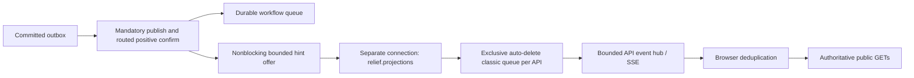

# Dispatch projection and offline view [A4.1]

The API remains a best-effort projection of the authoritative storage workflow.
No browser event or cached record proves present ownership. The frontend refreshes
current public records and only draws a line when both loaded sides are reciprocal.

`relief.projections` is a disposable, non-durable fanout exchange, declared at
runtime by projection publishers/subscribers. The canonical four durable exchanges,
seven queues, bindings, policies, confirms and outbox mark identities are unchanged.
Temporary UI queues never bind the workflow exchanges. Otherwise they could make a
mandatory publication look routed when its intended durable work queue is absent.
A real-broker negative regression covers exactly that case.

Each confirmed publisher has a separate best-effort worker/transport and a 64-hint
bounded queue. It offers a hint only after the original routed positive confirm.
A hint contains event/entity ID, entity version and type, plus trace headers;
it contains no request/resource details. Congestion or transport failure may drop
hints and cannot change the primary publish result or close the primary transport.
The per-API queue is server-named, exclusive, auto-delete classic, manual ack with
prefetch 8. Ack applies only to this disposable copy of an already committed event.
It never consumes `matching.requests` or `matching.wakeups`.

API SSE uses the existing `/api/v1/events` contract, UUID IDs and heartbeat comments.
Every connection requests a refresh even with Last-Event-ID: there is no replay log.
Broker reconnection asks clients to refresh; a slow client's 16-entry channel closes
the stream so it reconnects and refreshes. Periodic browser reads recover other
missed hints. Root cancellation closes streams before the API shutdown drain and
stops/joins the projection connection. The 5-second readiness propagation and 20-second
HTTP drain remain intact, including through the tracing response writer.

## Evidence and verification

`make verify-A4.1` runs model tests, real Chromium against the Go-served bundle,
and disposable pinned-RabbitMQ integration tests. Browser fixtures isolate UI state
transitions; a separate deployed-kind run must verify the actual API/relay/SSE chain.
`make check` verifies bundle source hashes and the Go regressions; generation must
leave frozen contracts/generated code unchanged.

See [the UI guide](../../ui/README.md) for tools, offline behavior, paging limits,
telemetry scope and protected-SSE setup.

Protocol references: [RabbitMQ publisher routing](https://www.rabbitmq.com/docs/publishers),
[publisher confirms](https://www.rabbitmq.com/docs/confirms),
[exclusive/temporary queues](https://www.rabbitmq.com/docs/queues).

## Rebuilding checked-in browser assets

Use `make ui-build`, which performs a clean pinned local dependency install
before building. Reusing a `node_modules` symlink from another checkout can
change esbuild's resolved input paths and therefore its generated asset names,
even when the emitted JavaScript bytes are identical. Keep the generated index,
service worker and manifest together; do not rename a bundle manually.

The [#140 build comparison](../evidence/A6.1/ui-recovery-20261107/build-provenance-20261110/README.md)
records the original shared-dependency layout, canonical clean builds and browser
verification. Check all generated files with `git diff -- ui/static` after a
canonical rebuild; a repeated build of the same source/install must be unchanged.
