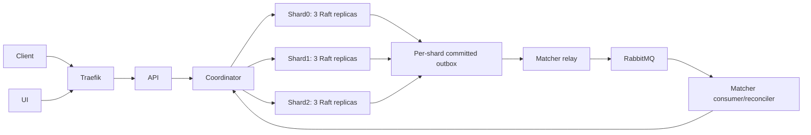

# Architecture, services, APIs and schemas

## Service boundaries and technology

| Deployable | Responsibility | Interface and implementation |
| --- | --- | --- |
| API | Validate clients, persist creations and status intents, expose reads and live projections | HTTP/JSON and SSE; [cmd/api](../../cmd/api), [handlers](../../internal/api) |
| Matcher | Consume durable work, match resources, relay outboxes, resume incomplete workflows | RabbitMQ and coordinator client; [cmd/matcher](../../cmd/matcher), [workflow](../../internal/workflow) |
| Coordinator | Own the fixed ring, track heartbeats, discover leaders and route calls | Private HTTP; [cmd/coordinator](../../cmd/coordinator), [client](../../internal/coordclient) |
| Storage node | Participate in one shard's Raft group and apply deterministic state changes | Raft transport and private HTTP; [cmd/storagenode](../../cmd/storagenode), [raftstore](../../internal/raftstore) |
| UI | Dispatch map/list, assignments, timeline and reconnect refresh | Browser assets and API/SSE; [ui](../../ui) |
| RabbitMQ | Durable quorum queues, routed publisher confirms, manual acknowledgements and retry tiers | AMQP plus private management; [topology](../../internal/mq/definitions.json) |

Relay, consumer and reconciler are worker roles inside the matcher deployable;
they are not counted as independent microservices. The project uses Go1.27,
HashiCorp Raft1.8, raft-boltdb/v2 and modernc SQLite. React/Leaflet provides the
dispatch UI; Helm and Traefik provide the local Kubernetes deployment. Exact
tool/library/image versions are in [go.mod](../../go.mod), [tools.mk](../../tools.mk)
and the [app chart](../../deploy/helm/reliefgrid).

## Partitioning, consistency and persistence

The coordinator uses a fixed xxhash64 ring with128virtual nodes, a ring version
and checksum. There are three logical shards with three voting replicas each.
Heartbeat discovery does not override Raft quorum authority. A healthy majority
can elect a leader; losing a majority makes committed service unavailable rather
than permitting divergent writes. See [ring contract](../../contracts/ring.yaml)
and [storage API](../../contracts/internal.yaml).

Raft log, stable store and snapshots live on a PVC. The SQLite FSM is derived
state on emptyDir, rebuilt from a snapshot and committed log during restart.
WAL and synchronous=OFF are appropriate only because Raft is the durable source;
an individual SQLite database is not advertised as the sole durability boundary.
The actual setup/schema is [internal/fsm/fsm.go](../../internal/fsm/fsm.go).

Each committed apply checks CAS, domain rules and operationId deduplication inside
one SQLite transaction. Proposers supply IDs and integer timestamps; apply does
not sample a clock or random generator. Reads use the configured committed-read
fence, with an explicit stale option for hints. Scatter-gather pages are not one
globally atomic three-shard snapshot. Failed shard reads cannot become empty
candidate lists; tests are in [FSM](../../internal/fsm) and
[workflow schedules](../../tests/workflow).

## SQLite schema

| Table | Key and important columns | Purpose |
| --- | --- | --- |
| records | key PK; kind, version, deleted, type, status, geohash, body, updated_at | Versioned request/resource data and generic metadata; index records_scan supports filtered scans |
| operation_results | operation_id PK; payload_hash, key, result, applied_index | Return the same committed result on an identical retry; reject different payload reuse |
| attempt_closures | resource_key + attempt_id PK; request_id, fingerprint, reason, disposition, closed_at | Permanent attempt fence independent of current resource ownership |
| outbox | seq PK; event_id UNIQUE, entity_key, entity_version, event, published, created_at | Atomically committed pending messages; outbox_pending index supports relay scans |
| meta | k PK; v | Applied-index and schema metadata |

The JSON body stores domain fields; SQL columns support indexing and versioned
access. Resource type/location are immutable in the core public API. A resource's
claim is controlled by workflow operations, never arbitrary public writes.

## Client and internal APIs

The [public OpenAPI](../../contracts/public.yaml) is the executable schema. Seven
PS operations are POST requests, GET request by ID, PUT request status, POST
resources, GET resources, PUT resource status, and POST match by request ID.
Canonical URLs use /api/v1; bare PS aliases are a separately reviewed ingress
follow-up and must be verified before claiming exact unprefixed-path compliance.
Status updates can return CANCELLING/FULFILLING while durable cleanup is pending.
Match200 means a completed result; match202 means a durable workflow is still
running, with Location pointing to the request.

| PS field | Stored/public representation |
| --- | --- |
| Request id | requestId UUID |
| Creation time | createdAt UTC |
| Resource id | resourceId UUID |
| Resource availability | windowStart/windowEnd plus current status |
| Request/resource type | WATER, FOOD, MEDICINE, TRANSPORTATION, SHELTER |
| Location | validated latitude/longitude; derived geohash for candidate indexing |

The private [internal contract](../../contracts/internal.yaml) includes node
registration/heartbeat, generic data access and domain commands. Operator paths
are token protected; comprehensive internal-call authentication is tracked in
issue29 and must not be described as deployed before its owner implementation.
