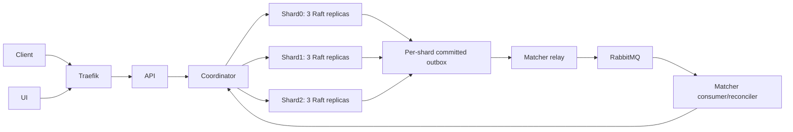

# Architecture, services, APIs and schemas

## Service boundaries and technology

| Deployable | Responsibility | Interface and implementation |
| --- | --- | --- |
| API | Validate clients, persist creations and status intents, expose reads and live projections | HTTP/JSON and SSE; [cmd/api](../../cmd/api), [handlers](../../internal/api) |
| Matcher | Consume durable work, match resources, relay outboxes, resume incomplete workflows | RabbitMQ and coordinator client; [cmd/matcher](../../cmd/matcher), [workflow](../../internal/workflow) |
| Coordinator | Own the fixed ring, track heartbeats, discover leaders and route calls | Private HTTP; [cmd/coordinator](../../cmd/coordinator), [client](../../internal/coordclient) |
| Storage node | Participate in one shard's Raft group and apply deterministic state changes | Raft transport and private HTTP; [cmd/storagenode](../../cmd/storagenode), [raftstore](../../internal/raftstore) |
| UI | Dispatch map/list, assignments, timeline and reconnect refresh | Browser assets and API/SSE; [ui](../../ui) |
| RabbitMQ | Durable quorum queues, routed publisher confirms, manual acknowledgements and retry tiers | AMQP plus private management; [topology](../../internal/mq/definitions.json) |

Relay, consumer and reconciler are worker roles inside the matcher deployable;
they are not counted as independent microservices. The project uses Go1.27,
HashiCorp Raft1.8, raft-boltdb/v2 and modernc SQLite. React/Leaflet provides the
dispatch UI; Helm and Traefik provide the local Kubernetes deployment. Exact
tool/library/image versions are in [go.mod](../../go.mod), [tools.mk](../../tools.mk)
and the [app chart](../../deploy/helm/reliefgrid).

## Source baseline

The integrated source baseline is main `42741b1306ba97013637c826ccb78aced5957b02`,
including merged public contract/API refinements #134/#136 and recovery #146.
Hrishabh supplied the storage/reliability contribution against `e50685d`; the
storage, internal contract, ring and admission source files cited below are
unchanged between those baselines. Public API references were checked against
the merged implementation. Historical evidence retains its original revision,
tree and runtime-image qualifications; it is not promoted to this source baseline.

## Topology and durable state

Storage has three independent logical shards and three voting Raft replicas per
shard: nine storage processes. Each replica runs HashiCorp Raft with a SQLite FSM,
and the coordinator routes keys to the owning shard. The storage StatefulSets
select data workers and use anti-affinity so a shard's replicas occupy different
data workers. See [placement](../../deploy/helm/storage/templates/statefulset.yaml#L17)
and the [ring contract](../../contracts/ring.yaml#L1). There are **128 virtual
nodes per shard, 384 tokens total**, not 128 tokens across the system. A two-of-three
majority can commit; loss of that majority prevents committed service on that
shard. These are shard guarantees, not a cross-shard transaction or a multi-host
cloud availability claim.

Durability comes from the Raft log and stable store in raft-boltdb and completed
Raft file snapshots on each replica's PVC. The persistent paths are
`<DataDir>/raft/raft.db` and `<DataDir>/snapshots`; the same Bolt store supplies
Raft's log and stable interfaces. See [persistent stores](../../internal/raftstore/node.go#L180)
and [Raft construction](../../internal/raftstore/node.go#L224). Majority replication
and these stores preserve committed history subject to the disk/filesystem
failure model. SQLite commit is the local visibility boundary after committed
commands apply; SQLite alone is not the durable source.

The FSM is derived state. Startup rebuilds its directory, restores the latest
completed snapshot and replays the committed log suffix once commit information
is known. See [startup](../../internal/raftstore/node.go#L236) and
[restore](../../internal/raftstore/statemachine.go#L109). SQLite is on emptyDir;
`/data` is a PVC ([volumes](../../deploy/helm/storage/templates/statefulset.yaml#L133)).
`fsm.Open` refuses an existing schema to prevent replay into an old database.
File-backed FSM databases use WAL and `synchronous=OFF`, one writer and a separate
query-only read pool capped at four connections ([FSM setup](../../internal/fsm/fsm.go#L73)).
Disabling SQLite sync does not disable the durability requirements of Raft's
persistent stores. Deleting all durable quorum history is outside the recovery
promise; local kind volumes are not an off-machine backup.

## Model and SQLite schema

Requests and resources are versioned records with typed JSON bodies and indexed
SQL metadata. Keys use `req:` and `res:` prefixes. Requests carry status,
urgency/effective urgency, intent and assignment information. Resources carry
availability, status and an optional active claim bound to request, attempt and
fingerprint. See [model and keys](../../internal/store/store.go#L76) and
[domain records](../../internal/store/store.go#L137). JSON retains domain data;
SQL metadata supports filtered scans and version checks.

| Table | Actual keys and columns | Storage purpose / source |
|---|---|---|
| records | key PK; kind, version, deleted, type, status, geohash, body, updated_at | Versioned entities/tombstones; records_scan index on kind/type/status/geohash. [schema](../../internal/fsm/fsm.go#L22) |
| operation_results | operation_id PK; payload_hash, key, result, applied_index | Durable retry history, including committed domain rejections. [schema](../../internal/fsm/fsm.go#L34) |
| attempt_closures | composite PK resource_key/attempt_id; request_id, fingerprint, reason, disposition, closed_at | Fence retained independently of later reuse. [schema](../../internal/fsm/fsm.go#L41) |
| outbox | seq INTEGER PK; event_id UNIQUE, entity_key, entity_version, event, published, created_at | Domain change/event commit together; pending index on published/seq. [schema](../../internal/fsm/fsm.go#L51) |
| meta | k PK, v | schema_version and applied_index. [schema](../../internal/fsm/fsm.go#L61) |

All five tables are reconstructed from snapshots/logs, including dedupe results,
closures and published/unpublished event history. Derived state does not make
these histories disposable protocol information. Arbitrary closure/outbox garbage
collection is not established: trace-aware dedupe depends on committed outbox
rows remaining available ([retention requirement](../../internal/fsm/apply.go#L40)).
Resource type/location are immutable in the core public API. Workflow operations
control claims; arbitrary public writes cannot assign ownership.

## Coordinator, routing and private APIs

The coordinator owns the fixed xxhash64 ring, checksum validation, registration,
heartbeats and leader discovery. The ring chooses the first token at or above a
key's hash and wraps at the end. Editing the ring alone does not migrate records;
the simulation endpoint is diagnostic. The single coordinator is stateless with
respect to domain data; nodes register again after restart
([coordinator](../../internal/coordinator/coordinator.go#L82)). Heartbeats support
routing and diagnostics, not authority to override a Raft majority.

| Private boundary | Contract anchors |
|---|---|
| Registration, heartbeat, ring discovery | [register](../../contracts/internal.yaml#L52), [heartbeat](../../contracts/internal.yaml#L99), [ring](../../contracts/internal.yaml#L140) |
| Generic read/create/CAS/delete | [data](../../contracts/internal.yaml#L157) |
| Scatter-gather scans | [scan](../../contracts/internal.yaml#L312) |
| Request transition, durable retry, aging | [transition](../../contracts/internal.yaml#L406), [retry](../../contracts/internal.yaml#L447), [age](../../contracts/internal.yaml#L482) |
| Resource transition, TryClaim, CloseAttempt, closure read | [transition](../../contracts/internal.yaml#L534), [claim](../../contracts/internal.yaml#L573), [close](../../contracts/internal.yaml#L626), [closure](../../contracts/internal.yaml#L666) |
| Per-shard outbox, published mark, operation-result lookup | [outbox](../../contracts/internal.yaml#L699), [mark](../../contracts/internal.yaml#L744), [operation](../../contracts/internal.yaml#L783) |
| Protected ring/node/locate/distribution/simulation diagnostics | [ring](../../contracts/internal.yaml#L811), [nodes](../../contracts/internal.yaml#L829), [locate](../../contracts/internal.yaml#L859), [distribution](../../contracts/internal.yaml#L883), [simulation](../../contracts/internal.yaml#L910) |

The coordinator forwards operationId, expected version and ringVersion unchanged.
Replies are verified against shard and server identity; ring mismatch is rejected
before forwarding ([contract](../../contracts/internal.yaml#L7),
[routing](../../internal/coordinator/route.go#L109)). A lost or unverified mutation
reply can remain OUTCOME_UNKNOWN; retries must not manufacture a new logical
operation. [Outcome mappings](../../contracts/README.md) distinguish committed
results from unknown outcomes.

Scans fan out to shards and return positions, partial status and failed-shard
information ([coordinator scan](../../internal/coordinator/scan.go#L38)). A failed
or partial read is never proof of an empty candidate set. Pagination is not a
globally atomic snapshot across three shards.

## Committed consistency and storage guarantees

Committed apply runs serially in log order. For domain commands with an operation
identity, one SQLite transaction contains precondition evaluation, domain changes,
outbox rows, operation result and applied-index update.
The in-memory applied counter advances only after SQLite commit
([apply boundary](../../internal/fsm/fsm.go#L264)). Competing same-version updates
are decided at committed apply, not by preliminary coordinator/leader reads.
Proposers supply IDs and integer timestamps; deterministic apply does not sample
wall time or randomness. Raft/proposer clocks and coordinator retry jitter are
outside FSM decision logic.

Deduplication reads operation_results inside that transaction. Identical retries
return the stored result with `Replayed=true`; incompatible operationId reuse
returns OPERATION_ID_REUSED. There is a narrow trace-envelope exception: a retry
differing only in supported outbox traceparent fields can match using committed
outbox values. Rejections without those outbox rows do not gain the exception
([dedupe and exception](../../internal/fsm/apply.go#L24)). Therefore "every byte
difference is rejected" would be too broad.

A proposal timeout or lost response can happen after commit. The API exposes
unknown outcome rather than claiming rejection ([proposal](../../internal/raftstore/node.go#L321),
[store outcomes](../../internal/store/store.go#L63)). Keep the intent, retry the
same operationId or use durable closure. A historical SUCCESS records what
happened to an operation, not who owns a resource now.

Read modes are explicit. Default strong reads use a committed log barrier; stale
reads are unfenced local diagnostic observations. The optional linearizable fence
avoids a log entry per steady-state read: establish an own-term commit, capture
the read index, obtain quorum acceptances for requests sent after read start,
reject term/role change and wait for SQLite's completed command index
([fence](../../internal/raftstore/fence.go#L11),
[contract](../../contracts/internal.yaml#L32)). Raft AppliedIndex alone can count
work handed to the FSM before SQLite commits; barriers/no-ops/configuration
entries also differ from command indexes ([index boundary](../../internal/raftstore/node.go#L94)).
`strongReadFence: fence` selects how explicit linearizable reads are implemented;
it does not change the contract's strong default
([storage values](../../deploy/helm/storage/values.yaml#L29)).

TryClaim checks permanent closure, recognizes the same bound claim, closes a
conflicting/ineligible attempt, or commits the eligible claim. Rejection-and-closure
intentionally changes fence state. CloseAttempt can fence a claim that never
arrived and releases only its exact bound active claim, never someone else's
([claim rules](../../internal/fsm/apply.go#L544),
[closure rules](../../internal/fsm/apply.go#L601)). The resource FSM cannot inspect
another shard's current request. Reciprocal cross-shard ownership also depends
on the application intent/confirmation/closure workflow. Local checks are not a
distributed transaction or an independent proof of the whole cross-shard invariant.

## Snapshots, admission and fault tolerance

Snapshots use an immutable VACUUM INTO SQLite image. Persist streams it behind a
header identifying group/shard, applied index, size and SHA-256. Restore stages
and validates the image before swapping the opened FSM
([snapshot/restore](../../internal/raftstore/statemachine.go#L66)). Startup removes
incomplete temporary snapshot directories ([startup](../../internal/raftstore/node.go#L215)).
A crash during transfer differs from a crash staging a fully received snapshot:
the latter can restore the completed local PVC snapshot on restart
([seam boundary](../operations/test-seams.md#L38)). Demo snapshot/compaction
thresholds are deliberately lower than the load profile
([profiles](../../deploy/helm/storage/values.yaml#L27)).

An empty disk never self-bootstraps ([open](../../internal/raftstore/node.go#L180)).
Incarnation identity is tied to persistent Raft state
([identity](../../internal/raftstore/identity.go#L14)). A replacement stays
admission-gated while the old voter could still be counted. `storagectl replace`
reads fresh peer/manifest state, commits old-member removal, records admission of
the new incarnation, adds it as nonvoter, waits for catch-up and promotes it.
Recorded phases allow interrupted replacement to resume
([replacement](../../cmd/storagectl/replace.go#L14),
[admission](../../internal/admission/admission.go#L1)). A new UUID alone does not
prevent an empty process at an old Raft address from being counted incorrectly.

Merkle audit compares replica content at the same completed command index,
including records/tombstones, operation results, closures and outbox; metadata
is checked separately. It narrows divergence to buckets/rows and distinguishes
incomplete or moving observations. Repair uses Raft, not selected SQLite-row copies
([audit/repair](../operations/merkle-audit.md)). Equal digests support convergence
for the observed state, not correctness of every possible execution.

## Client APIs and problem-statement mapping

The [public OpenAPI](../../contracts/public.yaml) is the executable schema. Seven
PS operations are POST requests, GET request by ID, PUT request status, POST
resources, GET resources, PUT resource status and POST match by request ID.
Canonical URLs use `/api/v1`; bare aliases remain separately reviewed in #128.
Status updates can return CANCELLING/FULFILLING while durable cleanup is pending.
Match 200 means a completed result; 202 means a durable workflow is still running,
with Location pointing to the request.

The current integrated baseline includes #134/#136: entity responses expose
strong ETags, optional If-Match protects status updates, and stale conditions
return 412 with the observed ETag. Unknown mutation outcomes remain 503. Public
continuations retain ring binding and require complete active-shard replies;
they remain query-bound observations, not global snapshots. See
[conditional update](../../internal/api/conditional.go),
[cursor implementation](../../internal/api/cursor.go),
[list implementation](../../internal/api/list.go) and
[API operational limits](../operations/api-refinements.md).

The original problem statement is *Emergency Response Matching.pdf*, SHA-256
`862d835d9904f237a7327d7f4f68bd6694ccf37dcc252e937e65bd19ca151d56`.
Section 3.1 starts on page 1 and continues on page 2; section 3.2 is on page 2.
The [original-field verification](https://github.com/ParthMalhotra07/ReliefGrid/pull/128#issuecomment-6759592216)
records the source wording and fingerprint. Its human labels map to this
implementation as follows:

| Original PS field label | Scope | Public representation / implementation choice |
|---|---|---|
| Unique request ID | Request | requestId UUID |
| Request type | Request | requestType; implemented resource-type enum |
| Location | Request/resource | location with validated latitude/longitude; derived geohash supports indexing |
| Request details | Request | details |
| Current status | Request/resource | status |
| Creation time | Request | createdAt UTC |
| Unique resource ID | Resource | resourceId UUID |
| Resource type | Resource | resourceType; implemented resource-type enum |
| Availability | Resource | windowStart/windowEnd plus current status |

The PS uses these human labels; it does not prescribe JSON member casing, state
who must set the creation timestamp, or define availability as a boolean versus
a time window. `requestId`/`resourceId`, server-supplied creation time, and
window-plus-status availability are implementation choices rather than literal
PS field names. The API proposer supplies integer timestamps, freezes them in
the durable keyed-creation intent and renders UTC `createdAt`
([creation implementation](../../internal/api/create.go#L77)). Original Table 2
on page 2 lists match success as 200; the additional 202 response here means
the durable workflow is still running, rather than reporting completed matching.
The PDF itself is local reference material and is not committed with this report.

Operator paths are token protected, but comprehensive internal-call authentication
is tracked in #29 and must not be described as deployed before implementation
and rollout. Bare-route alias compliance remains subject to #128's own review.
