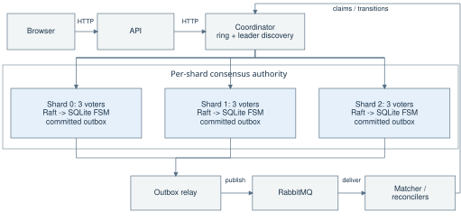
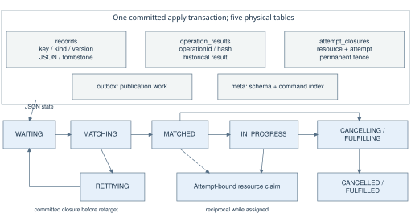
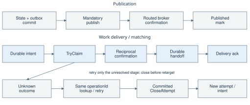
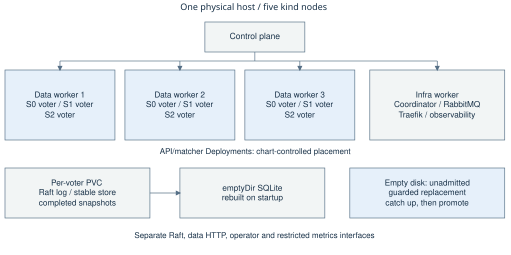

# ReliefGrid: replicated storage and asynchronous emergency-resource matching

Parth Malhotra and Hrishabh Sharrma

Working submission draft. Source baseline: b77e5b9761119a73bed8f2d3eede40c863492275. Historical runs retain their own revisions. Phase 2 evidence is reviewed at #176 (25ea8bc); its measured source remains 514bb33. Final gate and final submission reference pin remain outstanding.

## 1. Abstract and problem statement

An emergency request may remain unmatched until a compatible resource becomes available. ReliefGrid separates durable acceptance from assignment. Two Go application services, an HTTP API and asynchronous matcher, use three storage shards, each replicated by three Raft voters. Durable intents, conditional claims and permanent attempt closures coordinate assignments across shards. A transactional outbox bridges committed changes to RabbitMQ. Evaluation combines acknowledged-write ledgers, authoritative reads, invariant checks, replica audits and controlled local Kubernetes faults. Retained Phase 1 load reports bracket the HTTP threshold at 50 requests/s on one host; background matching and singleton availability are reported separately.

## 2. Requirement, service and API mapping

The API and matcher are the two application microservices; coordinator/storage provide the distributed data service. They never write SQLite directly. Go/net/http serves public and internal HTTP; Raft orders commands, SQLite implements the FSM, RabbitMQ schedules work, and Helm/kind provide deployment. The UI presents live or explicitly saved observations.

T3. PS Table 2 client operations. The canonical base is /api/v1; method/path-specific Traefik aliases reach the same handlers and preserve query strings and the idempotency namespace. Named UI routes are not intercepted. [1-3]

| Operation | Method and alias | Normal response |
|---|---|---|
| Submit request | POST /requests | 201 and canonical Location |
| Request details | GET /requests/{id} | 200 |
| Request status | PUT /requests/{id}/status | 200 |
| Register resource | POST /resources | 201 and canonical Location |
| List resources | GET /resources | 200 |
| Resource status | PUT /resources/{id}/status | 200 |
| Match request | POST /match/{requestId} | 200; 202 while deferred/running |

PS id fields map to requestId/resourceId, types to requestType/resourceType, creation time to server-persisted createdAt, and availability to windowStart/windowEnd plus status and absence of an active claim. A match 202 is not proof of assignment: clients read current request state. Lists/SSE extend the seven required operations; no bare /events alias is added.

## Internal mapping and client semantics

T4/T2. Internal functions and technology roles. The coordinator selects a fixed logical owner and discovers its leader; committed apply decides legality. [3-4]

| PS internal function | Interface | Authority / role |
|---|---|---|
| Registration; heartbeat | POST /internal/nodes/register; /internal/nodes/heartbeat | Discovery/health; Go HTTP |
| Data PUT / GET / DELETE | /internal/data/{key} | Coordinator routes; Raft/FSM commit |
| Workflow extensions | Claim, transition, close-attempt, operation lookup | Domain rules and durable dedupe |
| Enumeration/publication | Scan; outbox read and published marking | Complete-shard reads; durable handoff |

Keyed creates freeze canonical payload, identifiers, timestamps and original response across retries; changed-payload key reuse is rejected. Unknown outcomes retain the same identity. ETags/If-Match protect conditional updates. Cursors bind query/ring state; pages are not a global snapshot. A failed/partial shard scan cannot establish absence. Current ownership always requires authoritative state, not a historical successful operation result.

## 3. Architecture, sharding and consistency

Placement uses xxhash64 and 128 virtual nodes per shard, 384 tokens overall. The fixed ring carries ringVersion/checksum. Replica failure does not remap keys; leader discovery changes the destination within the owning shard. The PS gives hash mod 3 as an example; the ring reduces remapping when adding a shard. Simulation studies placement, not online data migration. The single coordinator is a routing dependency, not another consensus group. [3-4]

F1. The broker schedules work; shard consensus authorizes changes. Every shard has one illustrative leader and two followers, each with its own deterministic FSM/outbox. Management and read-only observability use separate interfaces. Roles change on election; ownership does not. Broker confirms and delivery acknowledgements return opposite to publication/delivery arrows.

## Durable state, schema and reads

Raft log/stable state and completed snapshots live on PVCs. SQLite is derived, uses WAL/synchronous=OFF and is rebuilt in emptyDir from durable Raft history. SQLite commit is the local visibility boundary, not the independent durability source. The guarantee depends on retained quorum history and the disk/filesystem failure model; local volumes are not off-machine backup.

Strong reads use a committed Barrier. The optional linearizable fence establishes an own-term commit, captures a read index, requires fresh majority evidence, rechecks term/leadership and waits for SQLite completion. Queued Raft apply and old acknowledgements are insufficient. The first term gate may still append a barrier. Stale reads are separate diagnostics. The integrated source includes #166: application callers default to linearizable and refuse missing/unknown authoritative served labels. Explicit strong calls retain Barrier behavior. The earlier Phase 1 and Phase 2 runs retain their own measured revisions; their results do not certify this assembled source as a newly load-tested deployment. [8]

Each command checks operationId deduplication, expected version, state and attempt rules in one committed SQLite transaction. Entity change, historical result, outbox event and completed-command index are recorded together. Proposers supply identifiers and integer timestamps; apply samples no wall clock/randomness and makes no unordered decisions. Resource and request claims are unique; live assignments require reciprocity and terminal requests hold no live claim. [4]

F2. Five physical tables participate in committed apply; their layout does not imply foreign keys. Logical request/resource states live in records JSON. The abbreviated state path includes MATCHING before MATCHED, and RETRYING is reached from MATCHING, not MATCHED/IN_PROGRESS. Cleanup reaches the corresponding terminal state only after closure. Some legal edges/dispositions are omitted; the committed FSM transition table is authoritative.

## 4. Workflow, claims, messaging and recovery

Creation commits state and its outbox event together. Relays read bounded per-shard batches, publish persistent messages with mandatory routing and confirms, then mark only routed confirmations. A crash after confirm and before marking can duplicate publication, so processing is idempotent. This avoids a database/broker dual-write gap without exactly-once transport. [4]

F3. Publication and matching are separate asynchronous paths. Confirmation precedes publication marking; ack follows the durable handoff. A timeout is not rejection. Only committed closure authorizes retargeting; delayed claims cannot reopen a closed attempt.

The matcher authoritatively reads the request and uses type/location/window filters for candidate hints. It records a MATCHING intent binding request, resource, attempt and fingerprint before TryClaim. The resource shard checks eligibility and closure in committed apply; reciprocal request confirmation checks current version/attempt. A fresh read never authorizes an unchecked future write.

Unknown results retain intent and operationId. A lookup/retry resolves the historical command, not present ownership. RETRYING fences confirmation until the old attempt closes. Cancellation and fulfilment remain CANCELLING/FULFILLING while closure and cleanup are pending. Reusable resources may return AVAILABLE; consumed resources remain CONSUMED and expired windows become OFFLINE. CloseAttempt releases only the bound claim.

Consumers use manual ack and prefetch 8, acknowledging only after the required durable transition/retry handoff. Retry queues have explicit dead-letter routing back to work; transient outages do not justify immediate nack loops. Reconcilers page bounded scans and resume intermediate states through the same rules. Recovery assumes eventual quorum/broker/worker availability; it is not a cross-shard transaction.

#168 preserves an earlier unknown through a later result-less routing 4xx. A verified committed result can resolve it; a pre-handler or malformed authentication refusal cannot. Durable callers preserve intent across process replacement and retry the same command. The deployed broker is a singleton even though its queues use the quorum type, so broker outage remains an availability limit. [4,6]

## 5. Docker/Kubernetes deployment and reproducibility

The supported target is local kind: one control plane, three data workers and one infra worker. The standalone storage Helm release owns coordinator, nine voters, PVCs, policies and bootstrap/admission tooling. The app release installs API/matcher/UI, RabbitMQ and ingress over it with storage.enabled=false, ensuring one storage owner. Multi-stage images run nonroot binaries. [4,9]

T8. Implementation and deployment pins at the declared report source. Optional observability tools are separate from the measured load profile. modernc names the Go driver, not the embedded SQLite engine release. See go.mod, tools.mk, UI package/lock files and Helm values. [2]

| Component | Technology and version | Role |
|---|---|---|
| Services | Go 1.27.2 | API, matcher, coordinator and storage |
| Consensus/log | hashicorp/raft 1.8.0; raft-boltdb/v2 2.4.2 | Replicated order and durable Raft state |
| State machine | modernc.org/sqlite 1.60.1 | Transactional, replayable derived state |
| Messaging | RabbitMQ 4.3.7 | Durable queues, routed confirmed publication |
| Local cluster | Kubernetes 1.37.0; kind 0.33.0 | Five-node local deployment |
| Packaging | Helm 3.22.1 | Installation and configuration |
| Ingress | Traefik 3.7.16; chart 42.1.2 | Public HTTP routing |
| Metrics | Prometheus 3.16.0; Grafana 13.3.0 | Scraping, dashboards and alerts |
| Tracing | OpenTelemetry Go 1.47.0; Collector 0.164.0; Jaeger 2.22.0 | Optional distributed traces |
| Load | k6 2.3.0 | Scripted HTTP load campaigns |
| Fault injection | Chaos Mesh 2.8.7 | Controlled Kubernetes faults |
| UI | React/React DOM 19.3.1; Leaflet 1.9.4; esbuild 0.28.2; Node.js 24.16.0 | Interface, maps and build tooling |

F4. Each data worker hosts one voter per shard. All five Kubernetes nodes share one physical host: this is not zone/host independence. PVC history survives an intact restart; an empty disk stays unadmitted until guarded replacement. Interfaces for Raft, data, management and metrics remain distinct.

Install pinned prerequisites and run make doctor. make dev creates/selects kind but is not a complete application install; make demo-reset installs the clean storage/app profile. make app-deploy upgrades the app over existing storage. Demos 6 and 7 are a coupled recovery sequence; run 7 immediately after 6. Follow the recovery runbook if interrupted. make gate recreates the selected disposable cluster twice by default. make cluster-down removes it. Never self-bootstrap an empty voter to make a demo pass.

Readiness drains before listener shutdown; consumers finish admitted durable handoffs. Metrics use bounded labels/private scrape access, with Grafana dashboards. Optional tracing propagates context across HTTP, outbox/AMQP and apply via Collector/Jaeger. Fixed replicas are the default; API HPA and matcher KEDA are separately verified options. Internal auth defaults off; accepting code does not establish live enablement/rotation.

Reproducibility requires cached dependencies/images, installation manifests and source/image binding, not just an archive command. Retained offline 9/9 reports certify their original kit, not a new final cohort. Cloud is parked. Final clean-clone/offline execution, swapped-presenter rehearsals and backup recording/playback retain their own acceptance records. [9]

## 6. Validation: course and scoped gate

The 12 November scoped gate used source 1623c23, fixed API2/matcher2, aging 0s, autoscaling off and auth excluded. It records course 18/18, replacement 63/63 with 1,794 acknowledged writes and none lost, app-quiesced chaos 12/12 runs (22 checks), Merkle 7/7 with 216 acknowledged writes and none lost, and clean/quiescent strict invcheck. These are recorded observations, not universal losslessness. [5]

T1. Nine PS demonstration outcomes. Each row passed in both clean rounds; acceptance is its retained assertions, not the title alone. Reset wrappers took 107/116 s on the recorded host.

| Demo / command | Required observation | R1 / R2 |
|---|---|---|
| 1 / make demo-1 | Create/read request | PASS / PASS |
| 2 / make demo-2 | Resource availability | PASS / PASS |
| 3 / make demo-3 | Type/location/window match | PASS / PASS |
| 4 / make demo-4 | Three-shard distribution | PASS / PASS |
| 5 / make demo-5 | Asynchronous burst | PASS / PASS |
| 6 / make demo-6 | Leader failure/write read-back | PASS / PASS |
| 7 / make demo-7 | Restart/replay/catch-up | PASS / PASS |
| 8 / make demo-8 | App death/interrupted calls | PASS / PASS |
| 9 / make demo-9 | Manual API scaling | PASS / PASS |

T5. Fault behavior and evidence boundaries. Ten chaos faults and two deliberate judge controls are not twelve ordinary production faults. [5-6]

| Fault | Required safe behavior | Evidence |
|---|---|---|
| Leader/partition/quorum loss | Fresh authority or unavailable | Gate; later #167 |
| Timeout / routing refusal | Same identity; uncertainty/closure retained | #168; ADR004 |
| Partial scan | Error/incomplete, never empty | Contract; scan tests |
| Broker return/redelivery/app death | Retain work; confirm/handoff before ack | ADR005; gate |
| Restart/empty disk | PVC rebuild / explicit M7 admission | Replacement/gate |
| Lag/stale projection | Raft progress plus completed-FSM/fresh reads | #167; UI tests |

The scoped gate's collector records fixed 2/2 replicas with no HPA/ScaledObject, but runtime build binding is NOT_ESTABLISHED for dev images. Some raw logs/screenshots remain outside the repository, listed in the report. Alias routes were deployed but not exercised by that gate; later forms were not part of its source. Final aliases/forms and excluded enhancements need their own accepted run.

Development and evaluation method. We divided the architecture plan into named goals, each implemented on its own branch and reviewed through a pull request. We wrote failing tests before implementing changes and used mutation checks to confirm that selected tests caught deliberately broken safety rules. Each of us reviewed the other's work, with particular attention to ownership boundaries and failure cases. Scripted demonstrations and clean deployment gates checked the required operations, recovery paths and replica counts. Separate chaos and load campaigns exercised faults and performance under recorded configurations, retaining command output, reports and checksums, with hashes and locations for raw files kept outside the repository. We kept incomplete audits, source and image qualifications, and untested combinations visible so that a passing run supported only the claim it actually checked.

## Later campaigns and application checks

The later #167 campaign kept API2/matcher2/UI1 active and passed 22 checks, distinct from the app-quiesced gate. Replication lag is max(0, leaderCommitIndex - followerRaftAppliedIndex), not commit minus last FSM command: barriers/no-ops/configuration entries do not advance that SQL counter. Its idle sample advanced commit 86174 to 86237 with FSM 85904, producing 333 false entries under the old formula and zero Raft-level lag. A real delay reached 51 then settled to zero; the stale-reader control detected 514 stale reads. Neither run establishes chaos safety under measured high load. [6]

Raft progress is not SQLite completion. Settle requires caught-up groups, equal completed-FSM indexes, acknowledged-ledger read-back and all nine members UP. Unreadable status is no sample, never zero. Merkle compares complete replicas at equal command indexes; it diagnoses divergence without proving the read protocol or repairing live rows.

Application evidence includes real-FSM adversarial schedules and retained kind/broker/browser tests. A historical scaling run records 637 aggregate CANCELLED/no-assigned-resource checks, not a per-request response ledger. Dirty source/missing immutable build binding limits it to recorded images; its final fixed-profile snapshot was unverified. Newer scoped-gate snapshots do not retroactively fill that gap. UI forms preserve key/body across reentry/unknown replies and require a current read: v3 cannot be confirmed by v2. Saved/offline state is labelled and offline writes disabled. [4-5,9]

## 7. Performance: Phase 1 and Phase 2

Seven retained reports use clean recorded source 7dd1940: three baselines, three step runs and one soak, seed 52, one 8-logical-CPU Core Ultra 7 258V host with 30.4 GiB RAM. kind used CPUs 0-5 and k6 6-7, Guaranteed resources, load Raft profile, fixed 2/2, tracing/autoscaling off. Source pins, recorded image IDs and a fence setting alone are not proof of immutable image binding or actual read-mode use. Phase 1 callers used strong/Barrier. [7]

T6a. Client HTTP p99 milliseconds; repeated-row values are medians of run percentiles, not pooled percentiles. HTTP completion is not sustained matching capacity.

| Run | Offered / achieved req/s | Write / ID / list p99 ms | Error fraction |
|---|---|---|---|
| Baseline, n=3 | 25 / 25 | 684 / 79.94 / 291.22 | 0.001 (0.100%) |
| Step, n=3 | 10-80 / 43.86 aggregate | 1049.34 / 102.43 / 367.06 | 0.00095 (0.095%) |
| Soak, n=1 | 35 / 35 | 838.84 / 93.75 / 330.37 | 0.001275 (0.1275%) |

## Load method and selected M6 study

Baselines measure 600 s and soak 1800 s after excluding 120 s HTTP warm-up; step runs measure 960 s without that warm-up. The mix is 15% creates, 10% resources, 10% match, 55% ID reads and 10% lists. All three step runs bracket the HTTP threshold at 50 req/s; write p99 crosses 1 s at 60. Other bounds are ID p99 <=250 ms, list p99 <=500 ms, errors <=1% and no dropped iterations. Baseline write p99 spans 665.75-690.92 ms. [7]

Requests intentionally outnumber resources. Baseline matched/WAITING counts are 1483/780; step counts 4276/2253. Matched-only latency excludes WAITING and includes resource availability. Backpressure remains visible: the soak records 416 unconfirmed publishes during load; one step records 5968 and 5209 in its after-run window. Those observations do not by themselves establish acknowledged data loss. Audits stopped retry admission, waited under the original headroom rule, drained handoffs, checked invariants and restored workers; this is not busy-system equilibrium. Off-repo raw artifacts retain hashes but were not re-read here.

T6b. Joint M6 experiment, derived from S4.1's existing study. Five samples/mode, 2000 iterations/sample, one process with three loopback replicas. Serial/parallel figures are benchmark ns/op; parallel throughput cost is not per-request tail latency. [8]

| Mode | Serial median ns/op | Parallel median ns/op | Steady-state entries/read |
|---|---|---|---|
| Barrier | 449566 | 112730 | 1 |
| Fence | 126084 | 23335 | 0 |

Ratios of medians are 3.566 and 4.831, not paired-trial speedups/confidence bounds. The raw benchmark omits runtime Go version; its source pin and separate safety run do not independently fill that omission. The term gate can still need a barrier. Shared-host noise and ordering constrain interpretation; this microbenchmark cannot establish whole-system load causality.

T6c. Placement simulation moves 24.93% of 10000 keys when extending three to four shards; it is synthetic, not live migration. Direct mod 3 to mod 4 would move an expected 75% under a uniform fixed hash; that is an analytical comparison, not a measured modulo deployment. [3]

## Phase 2 comparison

T6d. Same host and load profile; medians of three runs per phase; baselines offer 25 req/s. Historical revisions are 7dd1940 and 514bb33. Barrier counts cover the step window across all shards; refusal counts are global broker nacks, not lost acknowledged writes. [10]

| Measurement | Phase 1: strong default | Phase 2: linearizable default |
|---|---|---|
| HTTP saturation | 50 req/s; write p99 fails at 60 | >80 req/s; no tested step fails |
| Baseline write p99, ms | 684 | 93.57 |
| Baseline ID-read p99, ms | 79.94 | 56.43 |
| Baseline list p99, ms | 291.22 | 90.31 |
| Write p99 at 80 req/s, ms | 1180.37 | 388.50 |
| Barriers per step run | 270191 | 0 |
| Broker refusals per step run | 6324 | 8 |

Phase 1 issued one Raft barrier for each strong read; #166 made the linearizable fence the application default, removing steady-state read entries while retaining committed mutation checks. All three Phase 2 step runs passed through 80 req/s with clean invariant checks, audits and restoration. This establishes an HTTP lower bound above 80 req/s (n=3), not sustained matching capacity. Error rates remain nonzero: baseline median 0.000167 and step median 0.001093. The 29 residual counter differences are applied commands in flight at the end scrape, not barriers. [10]

Two exploratory runs (n=1 each) suggest a request-path limit near 100-110 req/s as list p99 exceeds 500 ms, but neither audit completed: one drain was refused and the other retained too much WAITING retry backlog. Generator memory or the 400-VU cap also limited results above 110 req/s. The coordinator is the next observed pressure point, reaching about 98% of its 250 mCPU allowance from 50 req/s; the request queue remains near capacity at upper steps. These observations do not prove a sole bottleneck or audited capacity at 110. [10]

Phase 2 adds no soak. The slim archive lists omitted raw files with hashes/locations; those off-repo files were not re-read here. The first step run's acceptance tail was completed by hand after the harness returned the documented above-range inconclusive result. The current #176 classifier labels the same threshold-clean range as a lower bound without hiding safety failures. The comparison was independently regenerated from retained request CSVs/report/extras inputs without drift; measurements remain bound to their historical source, not this final assembled artifact. [10]

## 8. Scope, decisions and conclusion

T7. PS section 12 decision matrix; rationales are not performance proofs. Other service/language, type/location matching and observability choices are covered above.

| Decision | Alternative | Why chosen / cost | Evidence |
|---|---|---|---|
| Raft | Primary-backup | Quorum order/elections; majority required | [4] |
| xxhash, 128 vnodes/shard | Modulo/dynamic placement | Stable versioned owner; no online migration | [3] |
| Derived SQLite FSM | Primary DB / memory | Transactional replay; rebuild cost | [4] |
| Transactional outbox | DB/broker dual-write | Atomic state/event; dedupe cost | ADR005 |
| Quorum queues | Classic/transient | Durable type; deployed broker still singleton | [4] |
| Fence versus Barrier | Barrier each read | No steady-state read entries; proof complexity | [8] |
| Linearizable default | Stale / strong only | Fresh reads; committed CAS/TryClaim decide writes; quorum dependency | [3,8] |
| kind | Managed cloud | Required repeatable local scope; one host | [9] |
| Open-model load | Closed-loop VUs | Offered/achieved gap and dropped work visible | [7] |
| Merkle audit | Full dumps/row copying | Equal-index localization; diagnostic only | [9] |

ReliefGrid demonstrates durable local matching with explicit uncertainty, committed claim fences and checked recovery. Singleton coordinator/broker, fixed membership and one-host placement bound availability realism. Positive aging, auth rollout/rotation and any final autoscaling option remain separately accepted goals. The final gate must cover its actual aliases/forms/source/images; final clean-clone/offline execution, rehearsals, recording and submission are not established by prepared scripts or this report.

## 9. References and repository evidence index

[1] Course Cloud Computing problem statement: Tables 2/3/8; sections 9, 10 and 12. Local deployment and live demo requirements are authoritative.

[2] [Implementation source baseline](https://github.com/ParthMalhotra07/ReliefGrid/tree/b77e5b9761119a73bed8f2d3eede40c863492275). Re-pin final submission; historical measurements retain their own revisions.

[3] [Public/internal/ring contracts and simulation](https://github.com/ParthMalhotra07/ReliefGrid/tree/b77e5b9761119a73bed8f2d3eede40c863492275/contracts). [4] [Architecture, workflow and ADR004/005](https://github.com/ParthMalhotra07/ReliefGrid/blob/b77e5b9761119a73bed8f2d3eede40c863492275/docs/report/architecture.md). [5] [12 November scoped gate](https://github.com/ParthMalhotra07/ReliefGrid/blob/b77e5b9761119a73bed8f2d3eede40c863492275/docs/evidence/gate-20261112T100532Z/report.md). [6] [Later #167 campaign](https://github.com/ParthMalhotra07/ReliefGrid/tree/b77e5b9761119a73bed8f2d3eede40c863492275/docs/evidence/S4.3/suite-20261112T155808Z-hrishabh-sharrma-ThinkPad-E14-Gen-7). [#168 unknown-outcome fix](https://github.com/ParthMalhotra07/ReliefGrid/pull/168). [7] [S5.2 Phase 1 reports/aggregates and methodology](https://github.com/ParthMalhotra07/ReliefGrid/tree/b77e5b9761119a73bed8f2d3eede40c863492275/docs/evidence/S5.2). [8] [ADR006 and retained M6 raw replay](https://github.com/ParthMalhotra07/ReliefGrid/blob/b77e5b9761119a73bed8f2d3eede40c863492275/docs/adr/006-read-fence-study.md). [9] [Deployment, Merkle audit and qualified validation/rehearsal records](https://github.com/ParthMalhotra07/ReliefGrid/blob/b77e5b9761119a73bed8f2d3eede40c863492275/docs/report/deployment-and-demo.md).

[10] [Phase 2 comparison, reviewed #176](https://github.com/ParthMalhotra07/ReliefGrid/blob/25ea8bc5675ab935d0b4852f8adbacb4cf14b9b3/docs/evidence/S5.2/phase2-linearizable/comparison.md) and [method/deviations/limits](https://github.com/ParthMalhotra07/ReliefGrid/blob/25ea8bc5675ab935d0b4852f8adbacb4cf14b9b3/docs/evidence/S5.2/phase2-linearizable/README.md). Raw measurement source 514bb33; evidence publication source 25ea8bc5675ab935d0b4852f8adbacb4cf14b9b3.
