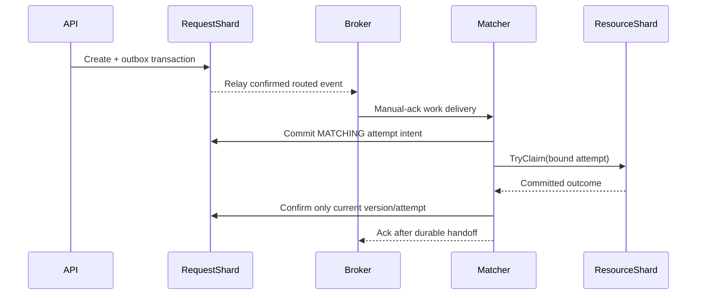

# Workflow and messaging methodology

## Request-to-assignment protocol

Creation validates the request, uses caller-scoped keyed idempotency when supplied,
and commits the request plus outbox event. A durable creation intent freezes IDs,
timestamps and response metadata across API crashes. Replaying a keyed creation
returns its original201and Location; it is not proof of present assignment.
See [creation handler](../../internal/api/create.go) and
[crash/replay tests](../../internal/api/recovery_test.go).

The matching workflow authoritatively reads the request, filters candidate hints
by type, availability window and distance, and chooses among the nearest eligible
candidates. Hints alone never establish ownership. It first records a MATCHING
intent with immutable attempt/resource binding, then asks the resource shard to
claim, then conditionally confirms the request. Only committed rules can create
a claim; a matched request must have a reciprocal resource claim. The code and
tests live in [internal/workflow](../../internal/workflow) and
[internal/geo](../../internal/geo).

## Closure, cancellation and unknown outcomes

An ambiguous claim response is not a rejection. Keep the intent and retry the same
operationId or enter RETRYING and durably close the old attempt before retargeting.
A historical successful operation result cannot recreate a claim that was later
closed. [ADR004](../adr/004-attempt-closure.md) explains this decision; the
[adversarial fixtures](../../tests/workflow/fixtures.go) enumerate interleavings.

Cancellation and fulfilment record CANCELLING/FULFILLING while cleanup is in
progress. The workflow closes the attempt, releases/consumes/offlines the resource
according to the recorded disposition, then commits terminal state. Reusable
resources can become AVAILABLE; consumed resources stay CONSUMED; expired windows
become OFFLINE. Terminal requests hold no live claim. See
[cleanup implementation](../../internal/workflow/cleanup.go) and
[API cleanup tests](../../internal/api/cleanup_test.go).

## Storage boundary supporting the workflow

TryClaim and CloseAttempt make resource-local decisions in the committed FSM
transaction. A permanent closure rejects a delayed claim; the same bound claim
is recognized, and closing an attempt releases only its exact active binding.
Rejection-and-closure can intentionally add fence state. The resource shard
cannot read another shard's current request, so these storage guarantees support
rather than replace the intent/confirmation/closure narrative above. See
[TryClaim](../../internal/fsm/apply.go#L544),
[CloseAttempt](../../internal/fsm/apply.go#L601) and
[architecture consistency limits](architecture.md).

## Outbox, broker and consumer boundaries

The transactional outbox prevents a committed domain change from losing its work
event if the proposer crashes before contacting RabbitMQ. Relays long-poll in
bounded per-shard batches, publish persistent messages with confirms and mandatory
routing, and mark only confirmed routed events. A crash after broker confirmation
and before marking creates duplicates, handled by idempotent processing. See
[outbox](../../internal/outbox), [messaging](../../internal/mq) and
[ADR005](../adr/005-outbox-handoff.md).

The canonical [definitions](../../internal/mq/definitions.json) include request
and wakeup work queues, delayed retry queues and a dead-letter queue. Consumers
use manual acknowledgement and bounded prefetch. They acknowledge only after
the necessary durable state/outbox handoff has committed. Transient outages use
bounded delayed retries/reconnection; they do not repeatedly nack healthy waiting
requests until the quorum delivery limit treats them as poison.

Broker delivery priority and business workflow retry count are separate concepts.
The pinned RabbitMQ quorum queue behavior is tested, not inferred from another
version. Priority aging needs a durable committed scheduler update and event;
it is not provided automatically by the broker and remains a separate A4.4 seam.

## Reconciliation and validation method

Reconcilers scan bounded cursor pages and resume stranded intermediate states.
A partial scan is unknown, never an empty successful sweep. Reconciler, consumer
and API all delegate to the same workflow rules rather than independent copies.
See [reconciler](../../internal/reconcile) and its tests.

Development proceeds from a failing regression to implementation, race/vet/lint
checks, a goal-specific live verification and owner review. Tests use the real
FSM through memstore for deterministic interleavings, then coordinator/kind fault
hooks for process crashes. [Schedule evidence](../evidence/A2.3/README.md) and
[schedule drivers](../../tests/workflow) identify what was actually exercised.
This supports named safety properties under tested faults, not a universal
exactly-once delivery or availability claim under every partition.
